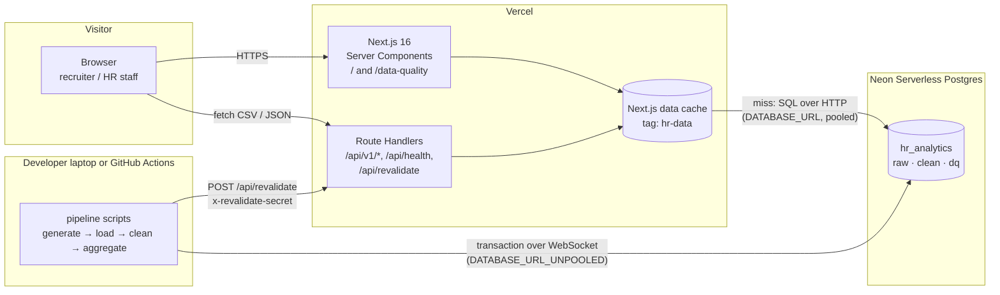

# HR ANALYTICS — ARCHITECTURE.md

> **Revision 1.** Architecture of `hr-analytics-site`: one Next.js 16 application (UI + read-only API) deployed on **Vercel**, one **Neon Serverless Postgres** database provisioned through the Vercel Marketplace, and an offline **data pipeline** (TypeScript scripts) that generates, loads, and cleans the dummy data. Requirements in `PRD.md`; tables in `SCHEMA.md`; coding rules in `RULES.md`; visual design in `DESIGN.md`.
>
> **Why this shape.** "Full-stack on Vercel" here means: the browser never talks to the database; Next.js Server Components and Route Handlers run as Vercel Functions and query Neon over HTTP; all writes happen in the pipeline, outside request handling. The site stays read-only, cheap (Vercel Hobby + Neon Free), and fast (data cached, revalidated only when the pipeline runs).

---

## 1. System Context



| Component | Responsibility |
|---|---|
| **Next.js app (Vercel)** | Renders the two pages, serves the read-only JSON/CSV API, holds no state of its own. |
| **Data cache** | Caches every query result under the tag `hr-data`; invalidated after a pipeline run. |
| **Neon Postgres** | System of record: raw tables (as generated), clean tables, data quality log. |
| **Pipeline** | Only writer to the database. Runs on the developer's machine (`pnpm db:setup`) or as a manual GitHub Actions workflow. Never runs inside a Vercel request. |

## 2. Tech Stack

| Layer | Choice | Notes |
|---|---|---|
| Framework | **Next.js 16** (App Router), React 19, TypeScript 5 strict | Pin the exact version in `package.json`; use the current 16.x patch (security releases are monthly). |
| Runtime | Node.js 22 on Vercel Functions | Next.js 16 needs Node ≥ 20.9. |
| Package manager | pnpm | |
| Styling | Tailwind CSS v4 (CSS-first `@theme`) + CSS variables from `DESIGN.md §3` | |
| Components | shadcn/ui (Radix primitives), themed through tokens | Only: Button, Select, Popover, Tabs, Tooltip, Table, Badge, Skeleton, Sheet (mobile nav). |
| Charts | Recharts | Client components; receive plain data props. |
| Theme | next-themes (`class` strategy, `light` / `dark` / `system`) | |
| Icons | lucide-react, stroke 1.75 | |
| Fonts | `next/font/google`: Plus Jakarta Sans; monospace: system stack | |
| Database | **Neon Serverless Postgres** (Postgres 17) via **Vercel Marketplace** | Integration injects `DATABASE_URL` (pooled) and `DATABASE_URL_UNPOOLED` into all Vercel environments. |
| DB driver | `@neondatabase/serverless` | `neon()` HTTP driver at runtime; `Pool` (WebSocket) in the pipeline for transactions. |
| ORM / migrations | Drizzle ORM + drizzle-kit | SQL migrations committed in `db/migrations/`. |
| Validation | zod | Query-string filters and API responses. |
| Data generation | `@faker-js/faker` (locale `id_ID`) + seeded PRNG | Fixed seed `20251231`. |
| CSV | `papaparse` | Parse in the loader, stringify in export routes. |
| Tests | Vitest, PGlite (`@electric-sql/pglite`) for in-process Postgres, Playwright + `@axe-core/playwright` | No Docker needed. |
| CI | GitHub Actions | Lint, typecheck, unit, golden-figure test, Playwright on the Vercel preview URL. |
| Hosting | Vercel (Hobby) | Preview deployment per pull request. |

## 3. Design Methodology

### 3.1 Layers

```
app/ (pages, route handlers, UI components)
   │  calls
   ▼
lib/queries/   read-only query functions, cached ('use cache' + cacheTag)
   │  uses
   ▼
lib/domain/    pure functions: KPI math, risk rule, number formatting, filter parsing
db/            Drizzle schema + client (runtime: HTTP driver)

pipeline/      generate · load · clean · aggregate  (writes; never imported by app/)
```

- `app/` never contains SQL. It calls one function from `lib/queries` per data block.
- `lib/queries` never formats for display; it returns typed numbers. Formatting lives in `lib/domain/format.ts`.
- `lib/domain` has no I/O and is 100% unit-tested.
- `pipeline/` may import `db/` and `lib/domain`, but `app/` must never import `pipeline/` (enforced by an ESLint `no-restricted-imports` rule).

### 3.2 Patterns used

| Pattern | Where |
|---|---|
| Raw → clean separation (medallion-style) | Raw tables are never modified; clean tables are rebuilt from raw on every run. |
| All-or-nothing pipeline | One transaction per run; failure keeps the previous clean data. |
| Precomputed row features | Rolling 3-month overtime/absence and bucket labels are stored on each clean row, so queries are simple `GROUP BY`s. |
| Tag-based cache invalidation | All reads tagged `hr-data`; pipeline calls `/api/revalidate` once at the end. |
| Golden-figure testing | The seeded dataset must reproduce `PRD.md` Appendix A exactly. |
| Content as code | Findings are templates in `content/findings.ts`, filled with query results. |

---

## 4. Data Pipeline

### 4.1 Steps

```mermaid
sequenceDiagram
  autonumber
  participant Dev as pnpm db:setup
  participant G as pipeline/generate.ts
  participant L as pipeline/load.ts
  participant C as pipeline/clean.ts
  participant DB as Neon (unpooled)
  participant V as Vercel /api/revalidate
  Dev->>DB: drizzle-kit migrate
  Dev->>G: SEED=20251231
  G-->>Dev: data/raw/E_site_employees.csv (400)<br/>data/raw/E_site_monthly.csv (4,514)
  Dev->>L: load CSVs
  L->>DB: BEGIN; TRUNCATE raw_*; COPY/INSERT as text; COMMIT
  Dev->>C: clean
  C->>DB: BEGIN
  C->>DB: INSERT dq_runs (status='running')
  C->>DB: normalise department via department_aliases (DQ-01, DQ-02)
  C->>DB: remove exact duplicates (DQ-03)
  C->>DB: impute empty overtime = 0, ot_imputed (DQ-04)
  C->>DB: validation checks (DQ-05 … DQ-08)
  C->>DB: TRUNCATE employees, employee_months; INSERT clean rows + features
  C->>DB: INSERT dq_issues, dq_alias_hits; UPDATE dq_runs (status='succeeded')
  C->>DB: COMMIT
  C->>C: verify golden figures (fails run if Appendix A drifts and SEED is default)
  C->>V: POST (x-revalidate-secret)
  V-->>C: 200 {revalidated: true}
```

### 4.2 Scripts (`package.json`)

| Script | Does |
|---|---|
| `pnpm data:generate` | Writes the two raw CSVs to `data/raw/` (committed to Git so reviewers can download them). |
| `pnpm db:migrate` | `drizzle-kit migrate` against `DATABASE_URL_UNPOOLED`. |
| `pnpm db:seed-ref` | Upserts `departments` and `department_aliases` from `data/*.csv`. |
| `pnpm pipeline` | `load` + `clean` + revalidate. |
| `pnpm db:setup` | `db:migrate` → `db:seed-ref` → `data:generate` → `pipeline`. |

### 4.3 Feature columns computed in `clean`

For each clean employee-month row (window over `employee_id` ordered by `month`):

| Column | Definition |
|---|---|
| `ot_cost_idr` | `overtime_hours × base_salary / 173 × 1.5`, rounded to whole rupiah |
| `ot_hours_3m_avg` | average `overtime_hours` over the current and up to 2 previous months |
| `ot_bucket` | `le20` / `20to40` / `gt40` from `ot_hours_3m_avg` (≤ 20, > 20 and ≤ 40, > 40) |
| `months_to_exit` | 0 in the leave month, 1 the month before, …; `NULL` for employees who never leave |
| `is_stayer` | true if the employee has 12 rows and never leaves |

### 4.4 Where the pipeline runs

- **Local (default):** `vercel env pull .env.local` gives the Neon variables, then `pnpm db:setup`.
- **GitHub Actions (optional):** workflow `pipeline.yml`, trigger `workflow_dispatch` only, secrets `DATABASE_URL_UNPOOLED`, `REVALIDATE_URL`, `REVALIDATE_SECRET`.
- **Never** in `next build` or a request handler. The Vercel build must succeed with an empty database (pages then show the empty state).

## 5. Rendering and Caching

- `next.config.ts`: `cacheComponents: true` (Cache Components).
- Every function in `lib/queries` starts with `'use cache'`, calls `cacheTag('hr-data')` and `cacheLife('days')`. Arguments (the parsed filter) are part of the cache key.
- Pages read `searchParams`, parse them with `parseFilters()` (zod), and pass the result to the query functions. Each data block is its own async Server Component wrapped in `<Suspense>` with a skeleton, so the shell renders immediately.
- `POST /api/revalidate` checks `x-revalidate-secret` against `REVALIDATE_SECRET` (constant-time compare) and calls `revalidateTag('hr-data', 'max')`.
- Charts are Client Components (`'use client'`) that receive already-shaped arrays; no data fetching in the browser except the CSV download links.
- Filter changes use `<Link>` / `router.replace` with a new query string; no client-side data store.

## 6. API Contract (`/api/v1`, read-only)

All responses are JSON (`snake_case`) unless the path ends in `.csv`. All endpoints accept the **filter query**:

| Param | Format | Default | Validation |
|---|---|---|---|
| `from` | `YYYY-MM` | first month in data (`2025-01`) | within data range |
| `to` | `YYYY-MM` | last month in data (`2025-12`) | ≥ `from` |
| `dept` | department code (`hauling`, `mining_ops`, `plant_maint`, `hse`, `hr_ga`, `finance`) | all | enum |

Invalid input → `400` with the error envelope (§6.4). Responses carry `Cache-Control: public, s-maxage=3600, stale-while-revalidate=86400`.

### 6.1 Dashboard data

| Method | Path | Returns | Query function |
|---|---|---|---|
| GET | `/api/v1/summary` | `{headcount_start, headcount_end, leavers, turnover_monthly_avg_pct, turnover_annual_pct, absenteeism_pct, overtime_cost_idr, overtime_hours_per_employee_month}` | `getSummary(f)` |
| GET | `/api/v1/monthly` | `[{month, headcount, leavers, turnover_pct, absenteeism_pct, overtime_hours, overtime_cost_idr}]` | `getMonthly(f)` |
| GET | `/api/v1/departments` | `[{code, name, headcount_start, leavers, turnover_pct, absenteeism_pct, overtime_hours_per_employee_month, overtime_cost_idr, cost_share_pct, risk_level}]` sorted by `turnover_pct` desc (ignores `dept`) | `getDepartments(f)` |
| GET | `/api/v1/analysis/overtime-leave` | `{buckets:[{bucket, label, rows, leavers, leave_rate_pct}], ratio_high_low, ratio_high_low_excl_imputed, r_overtime}` | `getOvertimeLeave(f)` |
| GET | `/api/v1/analysis/absence-leave` | `{leavers:{employees, absenteeism_pct}, stayers:{employees, absenteeism_pct}, ratio, r_absence}` | `getAbsenceLeave(f)` |
| GET | `/api/v1/findings` | `[{no, title, body, recommendation}]` (rendered text) | `getFindings(f)` |
| GET | `/api/v1/meta` | `{months:[…], departments:[{code,name}], latest_run:{id, finished_at, status}}` | `getMeta()` |

### 6.2 Data quality

| Method | Path | Returns |
|---|---|---|
| GET | `/api/v1/data-quality/summary` | `{run_id, finished_at, raw_rows, duplicate_rows, clean_rows, department_spellings, department_canonical, overtime_null_rows, overtime_null_pct}` |
| GET | `/api/v1/data-quality/issues` | `[{code, table_name, column_name, description, rows_affected, action, status}]` for the latest successful run |
| GET | `/api/v1/data-quality/aliases` | `[{raw_value, department_code, department_name, table_name, rows}]` |
| GET | `/api/v1/data-quality/overtime-null` | `{total, pct, by_department:[{code,name,rows}], sensitivity:{ratio_all, ratio_excl_imputed}}` |

### 6.3 Export and operations

| Method | Path | Returns |
|---|---|---|
| GET | `/api/v1/export/monthly.csv` | Clean employee-month rows (filtered), UTF-8 with BOM, comma-separated, header row with the `snake_case` column names from `SCHEMA.md` |
| GET | `/api/v1/export/departments.csv` | Department table as shown on the dashboard |
| GET | `/api/v1/export/dq-log.csv` | Issue log of the latest run |
| GET | `/api/health` | `{ok, db:"up"|"down", latest_run_id}`; no cache |
| POST | `/api/revalidate` | `{revalidated:true}`; requires `x-revalidate-secret`; `401` otherwise |

### 6.4 Error envelope

```json
{ "error": { "code": "invalid_filter", "message": "Periode tidak valid.", "details": [{ "field": "from", "issue": "after_to" }] } }
```

| HTTP | code | When |
|---|---|---|
| 400 | `invalid_filter` | Bad `from` / `to` / `dept` |
| 401 | `unauthorized` | Wrong or missing revalidate secret |
| 404 | `not_found` | Unknown route |
| 503 | `no_data` | No successful pipeline run yet |
| 500 | `internal_error` | Anything else (no internals in message) |

## 7. Frontend Structure

| Route | Content | Data |
|---|---|---|
| `/` | Dashboard (PRD FR-10 … FR-19) | `getSummary`, `getMonthly`, `getDepartments`, `getOvertimeLeave`, `getAbsenceLeave`, `getFindings`, `getMeta` |
| `/data-quality` | Data Quality Log, `#definisi`, `#batasan` (PRD FR-20 … FR-25) | `getDqSummary`, `getDqIssues`, `getDqAliases`, `getOvertimeNull` |
| `not-found`, `error` | Friendly pages in Bahasa Indonesia | — |

Server Components fetch; Client Components only for: theme toggle, filter controls, charts, mobile nav sheet.

## 8. Deployment (Vercel + Neon)

### 8.1 First deploy

1. Push the repo to GitHub. In Vercel: **Add New → Project → Import** the repo (framework preset: Next.js; build command `pnpm build`; no custom output).
2. In the Vercel project: **Storage → Create / Browse Marketplace → Neon (Serverless Postgres) → Add**. Choose the free plan and region **Singapore (`aws-ap-southeast-1`)**, closest to Indonesia. Connect it to Production, Preview, and Development. Vercel injects `DATABASE_URL`, `DATABASE_URL_UNPOOLED`, and the `PG*` / `POSTGRES_*` variables.
3. Set the Vercel Function region to **Singapore (`sin1`)** (`vercel.json` → `"regions": ["sin1"]`) so functions sit next to the database.
4. Add `REVALIDATE_SECRET` (random 32 bytes, base64) in **Settings → Environment Variables** for all environments.
5. Locally: `vercel link` → `vercel env pull .env.local` → `pnpm install` → `pnpm db:setup`. The last step calls `REVALIDATE_URL` (`https://<project>.vercel.app/api/revalidate`).
6. Open the production URL; check `/api/health` returns `{"ok":true,"db":"up"}`.

### 8.2 Environment variables

| Variable | Set by | Used by |
|---|---|---|
| `DATABASE_URL` | Neon integration | Runtime (pooled, HTTP driver) |
| `DATABASE_URL_UNPOOLED` | Neon integration | Pipeline and migrations (transactions) |
| `REVALIDATE_SECRET` | You | `/api/revalidate`, pipeline |
| `REVALIDATE_URL` | You (local `.env.local` / Actions secret) | Pipeline |
| `SEED` | optional, default `20251231` | Generator |
| `NEXT_PUBLIC_REPO_URL` | optional | Sidebar "Lihat kode" link (PRD open question 5) |

`.env.example` lists names only. `.env*.local` is git-ignored.

### 8.3 Preview deployments

Optional: enable Neon **Preview Branching** in the integration so each preview deployment gets its own database branch. Without it, previews read the production database (acceptable: the app is read-only).

### 8.4 Limits to respect

- Vercel Hobby is for non-commercial use — fine for a personal portfolio.
- Neon Free: a single small database is far below limits (≈ 5,000 rows). Compute scales to zero; the first request after idle may take ~0.5–1 s, which the cache hides for most visitors.

## 9. Project Structure

```text
hr-analytics-site/
├── app/
│   ├── layout.tsx                  fonts, ThemeProvider, AppShell
│   ├── page.tsx                    Dashboard
│   ├── data-quality/page.tsx       Data Quality Log
│   ├── not-found.tsx · error.tsx
│   └── api/
│       ├── v1/summary/route.ts … v1/meta/route.ts
│       ├── v1/data-quality/*/route.ts
│       ├── v1/export/[file]/route.ts
│       ├── health/route.ts
│       └── revalidate/route.ts
├── components/
│   ├── ui/                         shadcn primitives (themed)
│   ├── shell/                      Sidebar, Topbar, ThemeToggle, FilterBar, MobileNav
│   ├── dashboard/                  KpiCard, TrendChart, RiskList, OvertimeLeave, AbsenceLeave, CostDonut, FindingCard, DepartmentTable
│   └── data-quality/               DqStatCard, IssueTable, AliasList, OvertimeNullPanel, KpiDefinition, LimitsList
├── lib/
│   ├── queries/                    dashboard.ts, data-quality.ts, meta.ts
│   ├── domain/                     kpi.ts, risk.ts, format.ts, filters.ts, findings.ts
│   └── env.ts                      zod-validated env
├── content/
│   ├── findings.ts                 3 finding templates
│   ├── kpi-definitions.ts
│   └── limitations.ts
├── db/
│   ├── schema.ts                   Drizzle schema (SCHEMA.md)
│   ├── client.ts                   neon() HTTP client (runtime)
│   └── migrations/
├── pipeline/
│   ├── generate.ts · load.ts · clean.ts · revalidate.ts
│   ├── checks/                     dq-01 … dq-08
│   └── sql/                        clean.sql, features.sql
├── data/
│   ├── raw/E_site_employees.csv · E_site_monthly.csv
│   ├── departments.csv
│   └── department_aliases.csv
├── tests/
│   ├── unit/                       domain functions
│   ├── golden/                     pipeline on PGlite → Appendix A
│   └── e2e/                        Playwright + axe, both themes
├── drizzle.config.ts · next.config.ts · vercel.json
├── .github/workflows/ci.yml · pipeline.yml
└── README.md
```

## 10. Security and Privacy

| Concern | Control |
|---|---|
| Database credentials | Only in Vercel env vars and `.env.local`; never in Git or client bundles (`DATABASE_URL` is not `NEXT_PUBLIC_`). |
| Writes from the internet | None. No route handler writes to the database. `/api/revalidate` only clears cache and needs a secret. |
| SQL injection | Drizzle query builder / tagged templates only; filters validated by zod enums and regex before use. |
| Least privilege (proposed, ADR-05) | A `hr_reader` role with `SELECT` only, used by the runtime `DATABASE_URL`. |
| Visitor privacy | No cookies except the theme preference in `localStorage`; no third-party analytics (Vercel Web Analytics optional, cookie-less). |
| Fake data only | Generator uses Faker names; employee IDs are synthetic. README states the data is dummy. |
| Headers | CSP (`default-src 'self'`, fonts from self via `next/font`), `X-Content-Type-Options: nosniff`, `Referrer-Policy: strict-origin-when-cross-origin`, `frame-ancestors 'none'`. |

## 11. Observability

- Vercel Function logs (structured `console.log(JSON.stringify(...))` from route handlers on errors only).
- `/api/health` for a manual check or an uptime monitor.
- Pipeline prints a summary table (rows per step, DQ results, golden-figure check) and exits non-zero on failure.
- Optional: Vercel Speed Insights to show Core Web Vitals in the portfolio write-up.

## 12. Architecture Decisions

| ADR | Decision | Status |
|---|---|---|
| ADR-01 | One Next.js app for UI and API (no separate backend service) — simplest full-stack shape that deploys to Vercel as one project | Accepted |
| ADR-02 | Neon via Vercel Marketplace as the database (free tier, env vars injected, scale to zero) | Accepted |
| ADR-03 | Pipeline runs outside Vercel (local or GitHub Actions); runtime is read-only | Accepted |
| ADR-04 | Aggregate on the fly over precomputed row features instead of materialized views (≈ 4.5k rows; simpler) | Accepted |
| ADR-05 | Separate read-only DB role for the runtime | Proposed |
| ADR-06 | No authentication; public portfolio | Accepted (PRD §4) |
| ADR-07 | Recharts for charts (React-native, accessible container, small learning curve) | Accepted |

## 13. Implementation Notes (Revision 1 build)

Small, deliberate refinements made while implementing; everything else follows the sections above.

| Topic | What was built | Why |
|---|---|---|
| DB drivers | `db/drivers.ts` picks the driver from the URL: Neon host → `neon()` HTTP at runtime / WebSocket `Pool` in the pipeline; any other Postgres URL → node-postgres; `pglite:<dir>` → in-process PGlite. | Same code runs on Vercel + Neon, in CI service containers, and locally without a Postgres server. |
| Readers | SQL lives in `lib/queries/readers/*` (plain functions over a `Db`). `lib/queries/{dashboard,data-quality,meta}.ts` wrap them with `'use cache'`, `cacheTag('hr-data')`, `cacheLife('days')`. | The pipeline's golden check (§4.1) and the PGlite golden test call exactly the SQL the app uses. `app/` still never contains SQL. |
| KPI math | SQL returns sums; percentages are computed by `lib/domain/kpi.ts`. | One implementation per KPI (RULES §1.3). |
| Pipeline CLI | `pipeline/cli.ts <generate|migrate|seed-ref|pipeline>` behind the `pnpm` scripts; `.env.local` loaded with `node --env-file-if-exists`. | One entry point. |
| Seed of a run | `data/raw/manifest.json` (seed + sha256) is written by the generator; `dq_runs.seed` is set only when the CSVs match it, and only then is Appendix A enforced. | Honest provenance for CSVs from elsewhere. |
| `/api/v1/meta` | Also returns `sources {employee_rows, monthly_raw_rows, monthly_clean_rows}` and `failed_checks`. | Footer text and the "Ada pemeriksaan data yang gagal" banner. |
| Failed checks | Rows failing DQ-05/07/08 are kept out of the clean table; DQ-06 keeps the first leave flag. Run status stays `succeeded`, issue status `gagal`. | PRD §8.1 step 5 ("run continues") without violating clean-table constraints. |
| Generator | Builds the clean truth, then calibrates it with seeded local search (leaver matrix, overtime, absence raking, salaries) to the injected patterns; Superintendent/Manager are not eligible for paid overtime. | Reproduces Appendix A exactly from seed `20251231`. |
