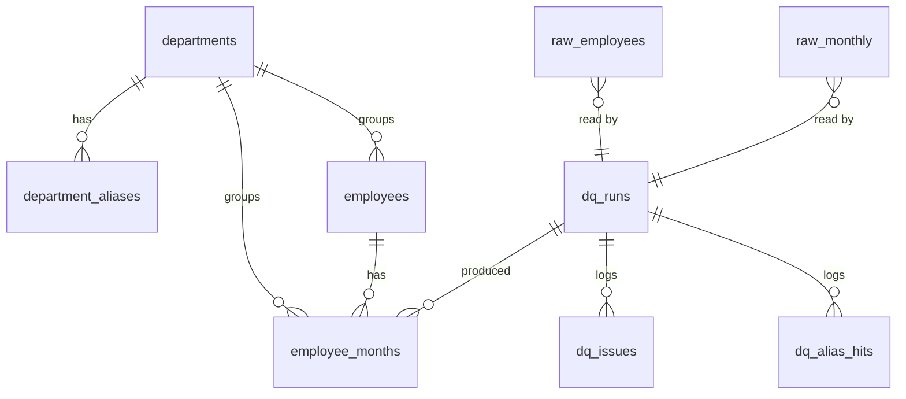

# HR ANALYTICS — SCHEMA.md

> **Revision 1.** Database schema of `hr_analytics` on **Neon Serverless Postgres** (Postgres 17), owned by the `hr-analytics-site` repository. Written by the pipeline only; read by the Next.js runtime. Requirements in `PRD.md`, data flow in `ARCHITECTURE.md §4`.

## Database: Neon Postgres 17 (provisioned through the Vercel Marketplace)
## Extensions: none required
## Migrations: drizzle-kit, SQL files in `db/migrations/`; schema source of truth in `db/schema.ts` (must match this document)

---

## 1. Conventions

| Rule | Detail |
|---|---|
| Naming | snake_case, plural table names; `pk_`, `fk_<table>_<column>`, `idx_<table>_<columns>`, `ck_<table>_<rule>` |
| Keys | Natural keys where the data has them (`employee_id`, `(employee_id, month)`, department `code`). `dq_runs.id` is a `uuid` generated in TypeScript (`crypto.randomUUID()`). |
| Time | `month` is a `date` on the first day of the month. Timestamps are `timestamptz` in UTC; the UI converts to WIB. |
| Money | `bigint` whole rupiah (IDR). Never floating point for money. |
| Hours / rates | `numeric(6,2)` for hours; percentages are computed in queries, not stored. |
| Enums | `text` + `CHECK` constraints (easy to migrate). |
| Raw tables | Every column `text`, exactly as in the CSV, plus `source_row`. No constraints except the primary key. |
| Clean tables | Rebuilt on every successful run (`TRUNCATE` + `INSERT` inside the run's transaction). |
| History | `dq_runs`, `dq_issues`, `dq_alias_hits` keep every run. |

## 2. Entity Relationship Overview



| Group | Tables |
|---|---|
| Reference | `departments`, `department_aliases` |
| Raw (as generated) | `raw_employees`, `raw_monthly` |
| Clean | `employees`, `employee_months` |
| Data quality | `dq_runs`, `dq_issues`, `dq_alias_hits` |
| Views | `v_month_department` |

---

## 3. Tables

### 3.1 Reference

```sql
CREATE TABLE departments (
  code        text PRIMARY KEY CHECK (code ~ '^[a-z_]+$'),   -- 'hauling'
  name        text NOT NULL UNIQUE,                          -- 'Hauling' (canonical, shown in UI)
  short_code  text NOT NULL UNIQUE CHECK (length(short_code) = 2),  -- 'HL' (avatar chip)
  sort_order  smallint NOT NULL
);

-- Raw spellings → canonical department. Key is the normalised spelling.
CREATE TABLE department_aliases (
  alias_normalized text PRIMARY KEY,            -- lower(trim(collapse spaces)), e.g. 'hauling', 'mining ops'
  department_code  text NOT NULL REFERENCES departments(code),
  example_raw      text NOT NULL,               -- one raw spelling for documentation, e.g. 'HAULING '
  CONSTRAINT ck_department_aliases_norm CHECK (alias_normalized = lower(btrim(regexp_replace(alias_normalized, '\s+', ' ', 'g'))))
);
```

### 3.2 Raw (exact copies of the CSVs)

```sql
CREATE TABLE raw_employees (
  source_row      integer PRIMARY KEY,          -- 1-based line number in the CSV (header excluded)
  employee_id     text,
  full_name       text,
  department      text,
  job_level       text,
  hire_date       text,
  base_salary     text,
  employment_type text
);

CREATE TABLE raw_monthly (
  source_row      integer PRIMARY KEY,
  employee_id     text,
  month           text,                         -- 'YYYY-MM-01'
  department      text,
  work_days       text,
  absent_days     text,
  overtime_hours  text,                         -- '' when empty (DQ-04)
  left_this_month text                          -- '0' / '1'
);
```
*Raw tables hold 400 and 4,514 rows. They are replaced only when the generator or the CSVs change.*

### 3.3 Clean

```sql
CREATE TABLE employees (
  employee_id      text PRIMARY KEY CHECK (employee_id ~ '^EMP[0-9]{4}$'),
  full_name        text NOT NULL,
  department_code  text NOT NULL REFERENCES departments(code),
  job_level        text NOT NULL CHECK (job_level IN ('Operator','Staff','Supervisor','Superintendent','Manager')),
  hire_date        date NOT NULL,
  base_salary_idr  bigint NOT NULL CHECK (base_salary_idr > 0),
  employment_type  text NOT NULL CHECK (employment_type IN ('PKWT','PKWTT'))
);
CREATE INDEX idx_employees_department ON employees (department_code);

CREATE TABLE employee_months (
  employee_id      text NOT NULL REFERENCES employees(employee_id),
  month            date NOT NULL CHECK (extract(day FROM month) = 1),
  department_code  text NOT NULL REFERENCES departments(code),
  work_days        smallint NOT NULL CHECK (work_days BETWEEN 1 AND 31),
  absent_days      smallint NOT NULL CHECK (absent_days >= 0),
  overtime_hours   numeric(6,2) NOT NULL CHECK (overtime_hours >= 0),
  ot_imputed       boolean NOT NULL DEFAULT false,      -- true when raw overtime was empty (DQ-04)
  left_this_month  boolean NOT NULL,
  -- features (ARCHITECTURE.md §4.3)
  ot_cost_idr      bigint NOT NULL CHECK (ot_cost_idr >= 0),
  ot_hours_3m_avg  numeric(6,2) NOT NULL,
  ot_bucket        text NOT NULL CHECK (ot_bucket IN ('le20','20to40','gt40')),
  months_to_exit   smallint CHECK (months_to_exit >= 0),  -- NULL for employees who never leave
  is_stayer        boolean NOT NULL,
  run_id           uuid NOT NULL REFERENCES dq_runs(id),
  PRIMARY KEY (employee_id, month),
  CONSTRAINT ck_employee_months_absent CHECK (absent_days <= work_days),
  CONSTRAINT ck_employee_months_exit CHECK (NOT left_this_month OR months_to_exit = 0)
);
CREATE INDEX idx_employee_months_month_dept ON employee_months (month, department_code);
CREATE INDEX idx_employee_months_exit ON employee_months (months_to_exit) WHERE months_to_exit IS NOT NULL;
-- At most one leave flag per employee (DQ-06 is also checked before insert).
CREATE UNIQUE INDEX uq_employee_months_one_exit ON employee_months (employee_id) WHERE left_this_month;
```

### 3.4 Data quality

```sql
CREATE TABLE dq_runs (
  id              uuid PRIMARY KEY,
  seed            integer,                      -- generator seed, NULL if CSVs came from elsewhere
  git_sha         text,
  started_at      timestamptz NOT NULL DEFAULT now(),
  finished_at     timestamptz,
  status          text NOT NULL CHECK (status IN ('running','succeeded','failed')),
  raw_employee_rows integer,
  raw_monthly_rows  integer,
  duplicate_rows    integer,
  clean_monthly_rows integer,
  overtime_null_rows integer,
  department_spellings integer,                 -- distinct raw spellings found (expected 16)
  error_message   text
);
CREATE INDEX idx_dq_runs_latest ON dq_runs (finished_at DESC) WHERE status = 'succeeded';

CREATE TABLE dq_issues (
  run_id         uuid NOT NULL REFERENCES dq_runs(id) ON DELETE CASCADE,
  code           text NOT NULL CHECK (code ~ '^DQ-[0-9]{2}$'),
  table_name     text NOT NULL CHECK (table_name IN ('employees','monthly')),
  column_name    text NOT NULL,                 -- '*' for whole-row checks
  kind           text NOT NULL CHECK (kind IN ('fix','check')),
  description    text NOT NULL,                 -- Bahasa Indonesia, shown in UI
  rows_affected  integer NOT NULL CHECK (rows_affected >= 0),
  action         text NOT NULL,                 -- Bahasa Indonesia, shown in UI
  status         text NOT NULL CHECK (status IN ('diperbaiki','perlu_konfirmasi','lolos','gagal')),
  PRIMARY KEY (run_id, code)
);

CREATE TABLE dq_alias_hits (
  run_id          uuid NOT NULL REFERENCES dq_runs(id) ON DELETE CASCADE,
  table_name      text NOT NULL CHECK (table_name IN ('employees','monthly')),
  raw_value       text NOT NULL,                -- exact raw spelling, spaces kept
  department_code text NOT NULL REFERENCES departments(code),
  is_canonical    boolean NOT NULL,             -- true if raw_value = departments.name
  rows            integer NOT NULL CHECK (rows > 0),
  PRIMARY KEY (run_id, table_name, raw_value)
);
```

### 3.5 View

```sql
-- Monthly totals per department; the base for summary, monthly, and department queries.
CREATE VIEW v_month_department AS
SELECT
  month,
  department_code,
  count(*)                                   AS headcount,
  count(*) FILTER (WHERE left_this_month)    AS leavers,
  sum(absent_days)                           AS absent_days,
  sum(work_days)                             AS work_days,
  sum(overtime_hours)                        AS overtime_hours,
  sum(ot_cost_idr)                           AS ot_cost_idr
FROM employee_months
GROUP BY month, department_code;
```

---

## 4. Seed and Reference Data

### 4.1 `departments`

| code | name | short_code | sort_order |
|---|---|---|---|
| `hauling` | Hauling | HL | 1 |
| `mining_ops` | Mining Operations | MO | 2 |
| `plant_maint` | Plant & Maintenance | PM | 3 |
| `hse` | HSE | HS | 4 |
| `hr_ga` | HR & GA | HG | 5 |
| `finance` | Finance | FN | 6 |

### 4.2 `department_aliases` (16 spellings → 6 departments)

| Raw spelling (example) | alias_normalized | department | Rows in monthly (seed 20251231) |
|---|---|---|---:|
| `Hauling` | `hauling` | hauling | canonical |
| `HAULING ` | `hauling` | hauling | 188 |
| `Haul` | `haul` | hauling | 140 |
| `Mining Operations` | `mining operations` | mining_ops | canonical |
| `Mining Ops` / `MINING OPS` | `mining ops` | mining_ops | 212 / 96 |
| `mining operation` | `mining operation` | mining_ops | 64 |
| `Plant & Maintenance` | `plant & maintenance` | plant_maint | canonical |
| `Plant&Maint` | `plant&maint` | plant_maint | 150 |
| `Maintenance` | `maintenance` | plant_maint | 98 |
| `HSE` | `hse` | hse | canonical |
| `K3/HSE` | `k3/hse` | hse | 52 |
| `HR & GA` | `hr & ga` | hr_ga | canonical |
| `HRGA` | `hrga` | hr_ga | 70 |
| `Finance` | `finance` | finance | canonical |
| `Fin & Acc` | `fin & acc` | finance | 56 |

Several raw spellings can share one normalised key (`HAULING ` and `Hauling` → `hauling`); `dq_alias_hits` records each raw spelling separately so the UI can show all 16. Total non-canonical rows in monthly: **1,126**.

### 4.3 Data quality checks (one `dq_issues` row each per run)

| Code | Table · column | Kind | Description (UI) | Expected rows | Status |
|---|---|---|---|---:|---|
| DQ-01 | monthly · department | fix | Nama departemen tidak seragam | 1,126 | diperbaiki |
| DQ-02 | employees · department | fix | Nama departemen tidak seragam di data master | 97 | diperbaiki |
| DQ-03 | monthly · * | fix | Baris duplikat persis | 20 | diperbaiki |
| DQ-04 | monthly · overtime_hours | fix | Nilai lembur kosong | 312 | perlu_konfirmasi |
| DQ-05 | monthly · absent_days | check | Hari absen melebihi hari kerja | 0 | lolos |
| DQ-06 | monthly · left_this_month | check | Karyawan tercatat keluar lebih dari sekali | 0 | lolos |
| DQ-07 | monthly · month | check | Masih ada baris setelah bulan keluar | 0 | lolos |
| DQ-08 | monthly · employee_id | check | employee_id tidak ada di data master | 0 | lolos |

A `check` with rows > 0 gets status `gagal`; the run still succeeds, and the dashboard shows a warning banner.

## 5. Key Queries (reference SQL)

Monthly turnover and absenteeism (all departments, filter applied in `WHERE`):

```sql
SELECT month,
       sum(headcount)                                   AS headcount,
       sum(leavers)                                     AS leavers,
       round(100.0 * sum(leavers) / sum(headcount), 2)  AS turnover_pct,
       round(100.0 * sum(absent_days) / sum(work_days), 2) AS absenteeism_pct
FROM v_month_department
WHERE month BETWEEN $1 AND $2 AND ($3::text IS NULL OR department_code = $3)
GROUP BY month ORDER BY month;
```

Overtime bucket vs leaving:

```sql
SELECT ot_bucket,
       count(*)                                         AS rows,
       count(*) FILTER (WHERE left_this_month)          AS leavers,
       round(100.0 * count(*) FILTER (WHERE left_this_month) / count(*), 2) AS leave_rate_pct
FROM employee_months
WHERE month BETWEEN $1 AND $2 AND ($3::text IS NULL OR department_code = $3)
GROUP BY ot_bucket;
```

Absence before leaving vs stayers:

```sql
SELECT 'leavers' AS grp, round(100.0 * sum(absent_days) / sum(work_days), 1) AS absenteeism_pct, count(DISTINCT employee_id) AS employees
FROM employee_months WHERE months_to_exit BETWEEN 0 AND 2
UNION ALL
SELECT 'stayers', round(100.0 * sum(absent_days) / sum(work_days), 1), count(DISTINCT employee_id)
FROM employee_months WHERE is_stayer;
```

Point-biserial correlation (Pearson with a 0/1 variable):

```sql
SELECT corr(left_this_month::int, ot_hours_3m_avg) AS r_overtime FROM employee_months;
```

*Note on the "stayers" count:* the dashboard label "338 karyawan bertahan" counts employees still present in December; `is_stayer` (12 rows, never left) is the same set because the dataset has no new hires (PRD Appendix B, item 3).

## 6. Database Roles

| Role | Rights | Used by |
|---|---|---|
| `neondb_owner` (created by the integration) | Owner of all objects | Migrations and pipeline (`DATABASE_URL_UNPOOLED`) |
| `hr_reader` *(proposed, ADR-05)* | `CONNECT`, `USAGE` on schema, `SELECT` on all tables and views | Runtime `DATABASE_URL` |

```sql
-- Proposed (ADR-05)
CREATE ROLE hr_reader LOGIN PASSWORD '<from secret store>';
GRANT USAGE ON SCHEMA public TO hr_reader;
GRANT SELECT ON ALL TABLES IN SCHEMA public TO hr_reader;
ALTER DEFAULT PRIVILEGES IN SCHEMA public GRANT SELECT ON TABLES TO hr_reader;
```

## 7. Migration Order

1. `0001_reference` — `departments`, `department_aliases`
2. `0002_raw` — `raw_employees`, `raw_monthly`
3. `0003_dq` — `dq_runs`, `dq_issues`, `dq_alias_hits`
4. `0004_clean` — `employees`, `employee_months` (references `dq_runs`)
5. `0005_views` — `v_month_department`
6. `0006_reader_role` — *(only if ADR-05 is accepted)*

Reference rows (§4.1, §4.2) are loaded by `pnpm db:seed-ref` from `data/departments.csv` and `data/department_aliases.csv`, not by migrations, so they can change without a schema change.

## 8. Retention

| Data | Retention |
|---|---|
| Raw and clean tables | Replaced on each run |
| `dq_runs` and children | Keep the last 50 runs; the pipeline deletes older ones at the end of a successful run |
